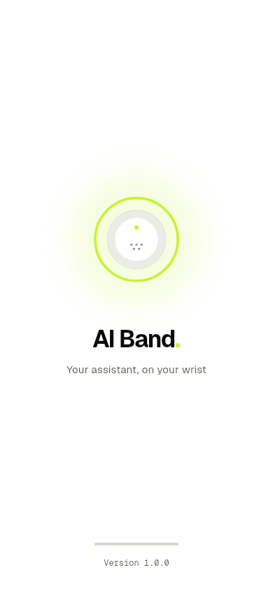
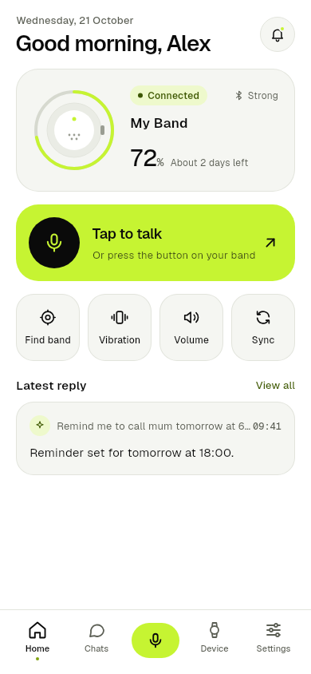
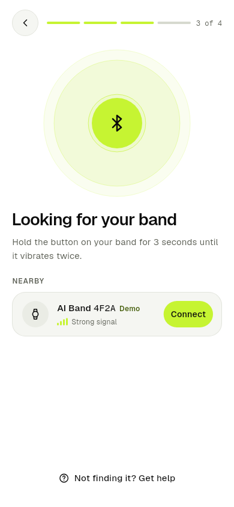
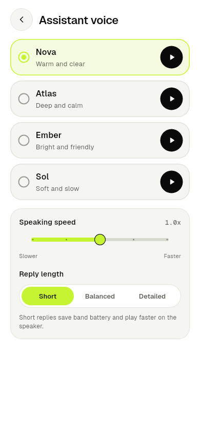
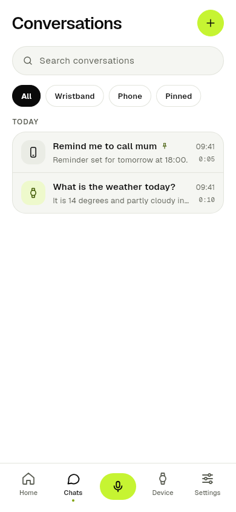

# AI-Band App

Flutter companion app for the ESP32-S3 AI wristband. It pairs with the band
over Bluetooth Low Energy, receives the voice recorded when the band button
is pressed, sends it to OpenAI (speech to text, chat, text to speech) and
plays the answer on the band speaker. 26 screens, light / dark / night
themes, line icons, and consistent motion throughout.

There is no login. Personal details, settings and conversations are stored on
the phone only.

## Screenshots

| Splash | Home | Pairing |
| :---: | :---: | :---: |
|  |  |  |

| Voice session | Conversations |
| :---: | :---: |
|  |  |

## First run

You need Flutter (stable channel) and either an Android phone or an iPhone
with a Mac. Bluetooth does not work in emulators, so test the band link on a
real phone.

```bash
cd "ESP32 Wristband App"
dart run tool/setup_platforms.dart   # adds android/ and ios/ plus all permissions (run once)
flutter pub get
flutter test                         # unit and widget tests
flutter run                          # runs with demo replies until the key is added
```

### Adding the OpenAI key

1. Copy `env.example.json` to `env.json`.
2. Paste the key into `OPENAI_API_KEY`.
3. Run `flutter run --dart-define-from-file=env.json`, or pick
   "AI Band (with env.json)" in the VS Code Run panel.

`env.json` is git ignored. Settings > About > AI connection shows "Ready"
once the key is loaded.

Note: a key built into an app can be extracted from the installed app. That
is fine for the MVP and testing. Before a store release, route the three
OpenAI calls through a small server (for example a Cloud Function) that holds
the key. Only `lib/services/openai_service.dart` needs to change.

### Trying it without the band

Settings > About > Demo band (or "No band yet? Try the demo band" on the
pairing screen) adds a simulated band. You can pair it and use every screen.
On the Device tab, a demo link puts the band on the charger so you can see the
charging home screen. On Find my band, tapping the radar moves the band closer.
With the demo band, voice uses the phone microphone and speaker.

## How a question flows

1. The band button (or the Talk button) starts a session. The band streams
   IMA ADPCM audio at 16 kHz on the `audioUp` characteristic.
2. The app decodes it to PCM, wraps it as WAV and sends it to
   `audio/transcriptions`.
3. The text goes to `chat/completions` with a system prompt made from the
   personal data, reply length and language settings.
4. The reply goes to `audio/speech` (24 kHz PCM). The app resamples it to
   16 kHz, encodes IMA ADPCM and streams it to the band on `audioDown`. When
   the band is charging or away, it plays on the phone instead.
5. The transcript and both audio clips are saved in Conversations.

The full Bluetooth protocol for the firmware is in
[docs/BLE_PROTOCOL.md](docs/BLE_PROTOCOL.md).

## Project layout

```
lib/
  main.dart, app.dart          start up, themes, page transitions
  config.dart                  build time settings (key, models, firmware URL)
  theme/tokens.dart            colours for light, dark and night, text styles
  ui/                          icons (SVG paths), animations, shared widgets
  models/models.dart           profile, settings, conversations, notices
  state/                       on device storage and service access
  services/
    band_service.dart          BLE link, commands, audio streaming, OTA, demo band
    ble_protocol.dart          UUIDs and opcodes shared with the firmware
    audio_codec.dart           IMA ADPCM, WAV, resampling
    openai_service.dart        transcription, chat, speech
    assistant.dart             the listening, thinking, speaking pipeline
    phone_audio.dart           phone mic and speaker
    firmware.dart              update check and install
  screens/                     one file per screen
tool/setup_platforms.dart      creates android/ios and adds permissions
test/                          unit and widget tests
docs/BLE_PROTOCOL.md           protocol for the ESP32 firmware
```

## Packages

| Package | Why | Licence |
| --- | --- | --- |
| universal_ble | Bluetooth Low Energy | BSD 3 |
| shared_preferences | on device storage | BSD 3 |
| record | phone microphone | BSD 3 |
| audioplayers | phone speaker | MIT |

flutter_blue_plus was not used, because its licence needs a paid commercial
licence for client work.

## Firmware updates

Set `FIRMWARE_MANIFEST_URL` to a JSON file such as:

```json
{ "version": "1.1.0", "notes": ["Clearer audio"], "url": "https://example.com/band-1.1.0.bin" }
```

When the band reports an older version, the Device tab offers the update. The
image is sent over the `ota` characteristic.

## Numbers to confirm with the hardware

Battery days left and minutes to full charge in `lib/ui/format.dart` are
placeholders (2.5 days from full, 110 minutes to charge). Update them once the
band is measured. The water resistance line stays "Rating pending test" until
IP testing is done.
